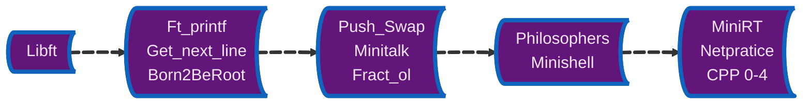
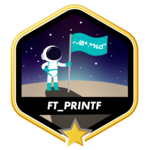
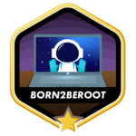
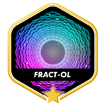
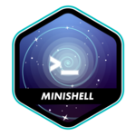
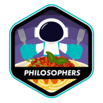
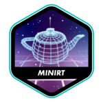

  

 

## 👋 About me

Hi, I'm **José**, a full stack software engineer with a background in pharmaceutical sciences, focused on **application security**.

- 🔐 I care about building software that handles sensitive data safely (health data was my starting point).
- 💼 Currently at **ECO**, working with WordPress, custom PHP and JavaScript, security and performance fixes, refactoring and migrations.
- 🎓 Finishing my Computer Science degree at the Polytechnic Institute of Setúbal (December 2026).
- 🖥️ Student at **42 Lisboa**.
- 🎯 Looking for full stack roles with an AppSec focus (C#/.NET, PHP, JavaScript).

## 🛠️ Languages and Tools

  <b>Web and backend</b>
   
  
   
  <b>Data</b>
   
  
  
   
  <b>Systems and tooling</b>
   
  
   
  <b>Mobile</b>
   
  
   
  <b>Documentation & Design</b>
   
  
   

## 🚀 Projects

| Project | What it is | Status | Source |
| --- | --- | --- | --- |
| **SIPIM** | Web application for pharmacies, built with ASP.NET MVC, C#, HTMX and SQL Server. For managing individual medication preparation.| Beta| Private |
| **SEGUES** | Web application for meal tickets and app orders, built with ASP.NET MVC, C#, HTMX and SQL Server. University group project.| Beta| Private |
| **Pharmacy internal tool (PHP)** | Built in plain procedural PHP and MySQL, with security first: prepared statements, hashed passwords, roles and input validation. Imports data exported from the pharmacy software. | Stand-by, planned migration to JS | Private|
> And more planned...

## 💻 42 School progress

  
  
  
  

  
  
  
  
  
  
  
  
  
  

## 📫 Contact

  
  

